<a name="abv-top"></a>

<p align="center">
  <a href="https://abvicky.in"></a>
</p>

<p align="center">
  <a href="#abv-work">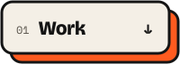</a>
  <a href="#abv-stack">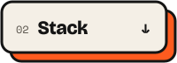</a>
  <a href="#abv-arcade"></a>
  <a href="#abv-contact"></a>
  <a href="https://abvicky.in"></a>
</p>

<p align="center">
  
</p>

<p align="center">
  
</p>

<p align="center">
  <a name="abv-work"></a><a href="#abv-top">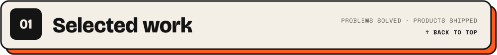</a>
</p>

<p align="center">
  <a href="https://merapaisaa.abvicky.in"></a>
</p>

<p align="center">
  <a href="https://github.com/ABVicky/JewelPOS">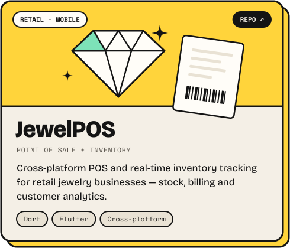</a>
  <a href="https://github.com/ABVicky/Digispire-Academy">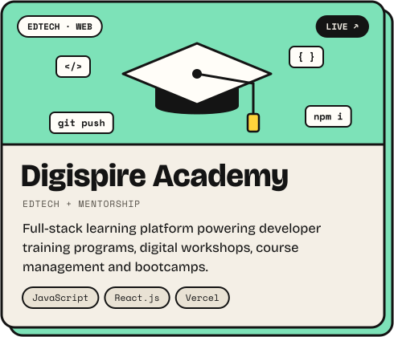</a>
</p>

<p align="center">
  <a href="https://github.com/ABVicky/VeriCRM">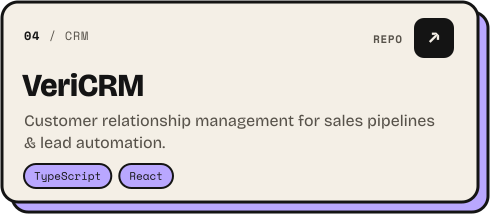</a>
  <a href="https://github.com/ABVicky/hrms">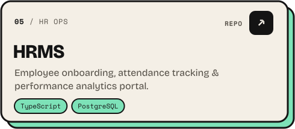</a>
  <a href="https://priyadarshi-ias-academy.vercel.app"></a>
  <a href="https://github.com/ABVicky/monorepo-turborepo"></a>
</p>

<p align="center">
  <a href="https://abvicky.in">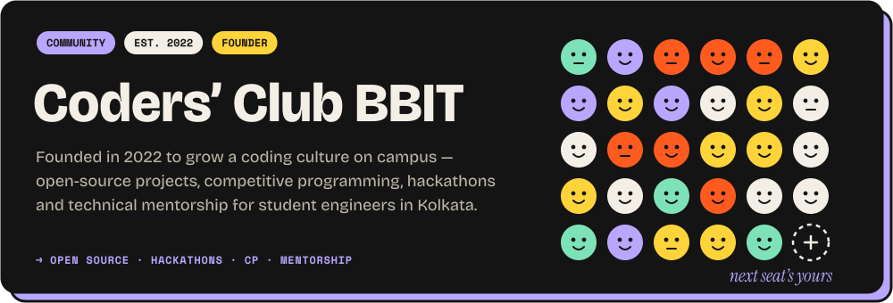</a>
</p>

<p align="center">
  <sub><b>SOURCE CODE →</b>
  <a href="https://github.com/ABVicky/merapaisaa">merapaisaa</a> ·
  <a href="https://github.com/ABVicky/Priyadarshi-IAS-Academy">Priyadarshi-IAS-Academy</a> ·
  <a href="https://github.com/ABVicky?tab=repositories">all repositories ↗</a></sub>
</p>

<p align="center">
  <a name="abv-stack"></a><a href="#abv-top">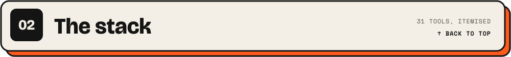</a>
</p>

<p align="center">
  
</p>

<p align="center">
  <a name="abv-arcade"></a><a href="#abv-top"></a>
</p>

<p align="center">
  
</p>

<p align="center">
  
  
</p>

<details>
<summary><a name="abv-reveal-1"></a></summary>
<br>

**It prints `object`.** One of JavaScript's oldest quirks: a bug from the language's very first version that can't be fixed without breaking the web. Check for `null` directly instead:

```js
if (value === null) { /* handle it */ }
```

</details>

<details>
<summary><a name="abv-reveal-2"></a></summary>
<br>

**It prints `false`.** JavaScript numbers are binary floating point, so `0.1 + 0.2` is really `0.30000000000000004`. Money apps should store amounts as whole paise (₹1 = 100 paise) and only format them for display:

```js
const total = 10 + 20;                          // paise
console.log(total === 30);                      // true
console.log(`₹${(total / 100).toFixed(2)}`);    // ₹0.30
```

</details>

<p align="center">
  
   console.log(i)); } — what does this print?">
</p>

<details>
<summary><a name="abv-reveal-3"></a></summary>
<br>

**It prints `[1, 10, 2]`.** Without a compare function, `sort()` turns every item into a string and compares them as text, so `"10"` lands before `"2"`. It also sorts the array in place. Pass a comparator, or use [`toSorted()`](https://developer.mozilla.org/en-US/docs/Web/JavaScript/Reference/Global_Objects/Array/toSorted) to get a new array:

```js
scores.sort((a, b) => a - b);        // [1, 2, 10]
const ranked = scores.toSorted((a, b) => b - a); // [10, 2, 1], original untouched
```

</details>

<details>
<summary><a name="abv-reveal-4"></a></summary>
<br>

**It prints `3`, `3`, `3`.** `var` is function-scoped, so all three callbacks share a single `i`, and they only run after the loop has finished, when `i` is already `3`. `let` creates a fresh `i` for every iteration:

```js
for (let i = 0; i < 3; i++) {
  setTimeout(() => console.log(i));   // 0, 1, 2
}
```

</details>

<p align="center">
  <sub>Got 4/4 without peeking? <a href="https://linkedin.com/in/abvicky">Tell me on LinkedIn ↗</a></sub>
</p>

<p align="center">
  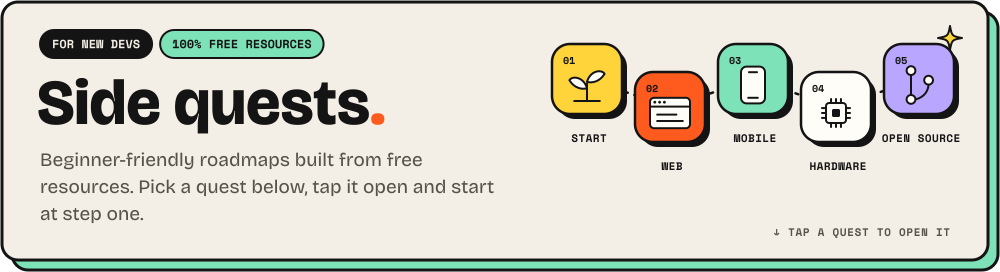
</p>

<details>
<summary><a name="abv-quest-1"></a></summary>
<br>

1. **How the web works, HTML & CSS** → [MDN: Learn web development](https://developer.mozilla.org/en-US/docs/Learn_web_development)
2. **JavaScript fundamentals** → [javascript.info](https://javascript.info/) (Part 1 is plenty to start)
3. **Git & GitHub basics** → [GitHub Skills](https://skills.github.com/)
4. **Practice with structure** → [The Odin Project: Foundations](https://www.theodinproject.com/paths/foundations/courses/foundations) or [freeCodeCamp](https://www.freecodecamp.org/learn)
5. **Learn to think like a programmer** → [Harvard CS50x](https://cs50.harvard.edu/x/) (free)

🏁 **Boss level:** build a one-page portfolio and put it online with [GitHub Pages](https://pages.github.com/).

</details>

<details>
<summary><a name="abv-quest-2"></a></summary>
<br>

1. **TypeScript** → [The TypeScript Handbook](https://www.typescriptlang.org/docs/handbook/intro.html)
2. **React** → [react.dev/learn](https://react.dev/learn)
3. **Next.js** → [Next.js Learn](https://nextjs.org/learn)
4. **APIs & databases** → [Node.js Learn](https://nodejs.org/learn) + the [PostgreSQL tutorial](https://www.postgresql.org/docs/current/tutorial.html)
5. **See the whole map** → [roadmap.sh: Full Stack](https://roadmap.sh/full-stack)

🏁 **Boss level:** solve a real problem for someone you know. Build it, ship it, watch them use it. Bonus: make it installable with [web.dev: Learn PWA](https://web.dev/learn/pwa).

</details>

<details>
<summary><a name="abv-quest-3"></a></summary>
<br>

1. **Dart** → [The Dart language tour](https://dart.dev/language)
2. **Flutter** → [Install Flutter and build your first app](https://docs.flutter.dev/install)
3. **Save data on the device** → [Flutter cookbook: Persistence](https://docs.flutter.dev/cookbook/persistence)
4. **Ship it** → [Build and release an Android app](https://docs.flutter.dev/deployment/android)

🏁 **Boss level:** a stock & billing app for a local shop, the idea behind [JewelPOS](https://github.com/ABVicky/JewelPOS).

</details>

<details>
<summary><a name="abv-quest-4"></a></summary>
<br>

1. **Electronics basics** → [Arduino: Getting started](https://docs.arduino.cc/learn/starting-guide/getting-started-arduino/)
2. **No board yet? Simulate one** → [Wokwi](https://wokwi.com/) (free, in the browser)
3. **Single-board computers** → [Raspberry Pi projects](https://projects.raspberrypi.org/en)
4. **Talk to a device from a web app** → [Web Serial API](https://developer.mozilla.org/en-US/docs/Web/API/Web_Serial_API)
5. **Connect many devices** → [MQTT: Getting started](https://mqtt.org/getting-started/)

🏁 **Boss level:** read a sensor on a microcontroller and stream it live to a web dashboard.

</details>

<details>
<summary><a name="abv-quest-5"></a></summary>
<br>

1. **Rehearse the flow** → [first-contributions](https://github.com/firstcontributions/first-contributions)
2. **Learn Git properly** → [Pro Git](https://git-scm.com/book/en/v2) (free book)
3. **Find a beginner-friendly issue** → [goodfirstissue.dev](https://goodfirstissue.dev/) or GitHub's [good first issue search](https://github.com/search?q=label%3A%22good+first+issue%22+state%3Aopen&type=issues)
4. **Contribute like a pro** → read `CONTRIBUTING.md`, comment before you code, keep PRs small ([Open Source Guide](https://opensource.guide/how-to-contribute/))

🏁 **Boss level:** get one PR merged, then help the next person land theirs.

</details>

<p align="center">
  <sub>Stuck on a quest? I mentor student developers. <a href="https://linkedin.com/in/abvicky">Message me on LinkedIn ↗</a></sub>
</p>

<p align="center">
  
</p>

<p align="center">
  <a name="abv-contact"></a><a href="mailto:abvicky01@gmail.com">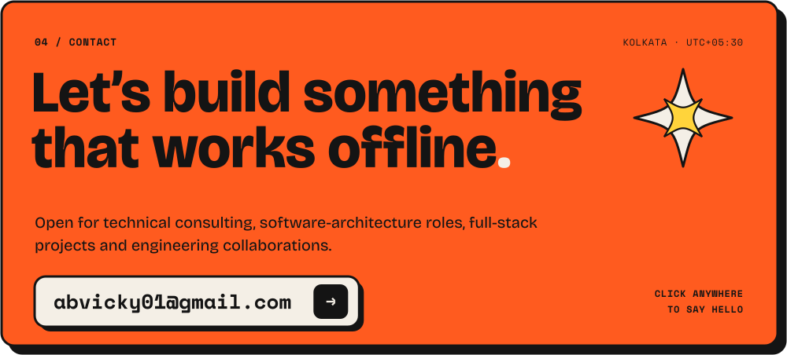</a>
</p>

<p align="center">
  <a href="https://linkedin.com/in/abvicky"></a>
  <a href="https://github.com/ABVicky"></a>
  <a href="https://quora.com/profile/AB-Vicky-Prasad-Mahato"></a>
  <a href="https://abvicky.in"></a>
</p>

<p align="center">
  <a href="#abv-top">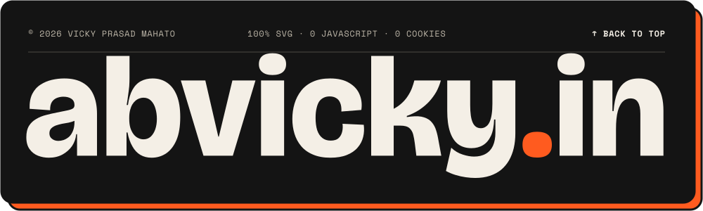</a>
</p>

<p align="center">
  
</p>
