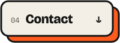
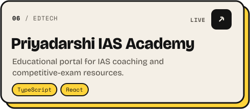
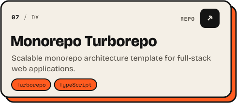
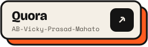

  

  
  
  
  
  

  

  

  

  
  

  
  
  
  

  

  <b>SOURCE CODE →</b>
  <a href="https://github.com/ABVicky/merapaisaa">merapaisaa</a> ·
  <a href="https://github.com/ABVicky/Digispire-Academy">Digispire-Academy</a> ·
  <a href="https://github.com/ABVicky/VeriCRM">VeriCRM</a> ·
  <a href="https://github.com/ABVicky/Priyadarshi-IAS-Academy">Priyadarshi-IAS-Academy</a> ·
  <a href="https://github.com/ABVicky?tab=repositories">all repositories ↗</a>

  

  

  

  <picture>
    <source media="(prefers-color-scheme: dark)" srcset="https://raw.githubusercontent.com/ABVicky/ABVicky/output/github-snake-dark.svg">
    <source media="(prefers-color-scheme: light)" srcset="https://raw.githubusercontent.com/ABVicky/ABVicky/output/github-snake.svg">
    
  </picture>

  

  

  
  
  
  

  

  

